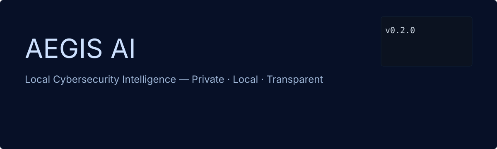

<p align="center">
  
</p>

<p align="center">
  <a href="#english">🇬🇧 English</a> · <a href="README.ru.md">🇷🇺 Русский</a>
</p>

<p align="center">
  <a href="LICENSE"></a>
  
  
  
</p>

---

## ⚡ Overview

**AEGIS AI** is an autonomous defensive cybersecurity and hardening toolkit designed for **AI coding agents** (Antigravity, Claude Code, Cursor, Codex) and terminal power users.

It combines an **Agent Skill (`SKILL.md`)** with lightweight, **zero-dependency Python engines** to audit Linux host security posture, triage incident logs, and detect leaked credentials before code hits production.

> [!NOTE]
> **Zero External Dependencies**: AEGIS relies exclusively on the Python standard library and standard POSIX system utilities. No heavy wheels, no network exfiltration, 100% private and local.

---

## 🛡️ Core Capabilities

```
                  ┌──────────────────────────────┐
                  │           AEGIS AI           │
                  └──────────────┬───────────────┘
                                 │
     ┌───────────────────────────┼───────────────────────────┐
     ▼                           ▼                           ▼
🔍 Secret Scanner           🛡️ Host Auditor           📑 Incident Triage
Exposed tokens, private     ASLR, SUID binaries,       SSH brute-force bursts,
keys, and cloud API keys    file perms & open ports    web scans & sudo abuse
```

### 1. 🔍 Credential & Secret Scanner (`scripts/aegis_scan.py`)
* Detects leaked private keys (RSA, OpenSSH, PGP, EC), GitHub PATs, AWS access keys, Telegram bot tokens, OpenAI/Gemini API keys, and database connection strings.
* Automatic secret masking in outputs to prevent log leakage.
* Fast recursive directory traversal ignoring binary blobs and build artifacts.

### 2. 🛡️ Linux Host Hardening Auditor (`scripts/aegis_audit.py`)
* Audits kernel memory protections (ASLR `randomize_va_space`).
* Scans standard binary paths for dangerous SUID/SGID binaries (GTFOBins targets).
* Audits world-writable sensitive files (`/etc/passwd`, `/etc/shadow`) and SSH directory permissions.
* Identifies publicly listening TCP sockets (`0.0.0.0` vs `127.0.0.1`) and SSH root login configurations.
* Calculates an automated **Security Posture Score (0-100)** and letter grade (A/B/C/D).

### 3. 📑 Incident Forensics & Log Triage (`scripts/aegis_triage.py`)
* **Auth Logs (`auth.log`/`secure`)**: Aggregates failed SSH login bursts, clusters attacker IPs, identifies sudo privilege violations.
* **Web Logs (Nginx / Apache)**: Flags path traversal attempts (`../`), sensitive file probes (`.env`, `wp-config.php`), and automated scanners (`sqlmap`, `nikto`, `nuclei`, `gobuster`).

---

## 🚀 Quickstart

### Option A: Use as an Agent Skill (Recommended)

Copy AEGIS into your agent's skills directory:

```bash
# For Google Antigravity / Agentic Coding Assistants:
git clone https://github.com/dyrnoi404/aegis-ai.git ~/.gemini/config/skills/aegis-security
```

Once installed, your AI agent automatically activates the `aegis-security` skill when asked:
* *"Audit my system's security posture"*
* *"Scan this repo for leaked secrets before pushing"*
* *"Check /var/log/auth.log for brute force attacks"*

---

### Option B: Use as a Standalone CLI

You can run AEGIS directly from the terminal without installing any extra packages:

```bash
# Clone the repository
git clone https://github.com/dyrnoi404/aegis-ai.git
cd aegis-ai

# 1. Audit Linux host security posture
./cli/aegis audit

# 2. Scan a directory for leaked credentials
./cli/aegis scan /path/to/project

# 3. Triage system authentication logs
./cli/aegis triage /var/log/auth.log
```

---

## 📁 Repository Layout

```
aegis-ai/
├── SKILL.md                  # Autonomous Agent Skill instructions & heuristics
├── README.md                 # English documentation
├── README.ru.md              # Russian documentation
├── LICENSE                   # MIT License
├── cli/
│   └── aegis                 # Unified executable CLI entrypoint
├── scripts/
│   ├── aegis_scan.py         # Secret & credential scanner
│   ├── aegis_audit.py        # Host hardening & posture auditor
│   └── aegis_triage.py       # Incident & log forensics analyzer
├── references/
│   └── hardening_checklist.md # Linux hardening reference baseline
└── docs/
    └── architecture.md       # Architecture & design breakdown
```

---

## 📜 License

Distributed under the **MIT License**. See [LICENSE](LICENSE) for more information.

Developed & maintained by [@dyrnoi404](https://github.com/dyrnoi404) · [Telegram](https://t.me/not_mudota)
