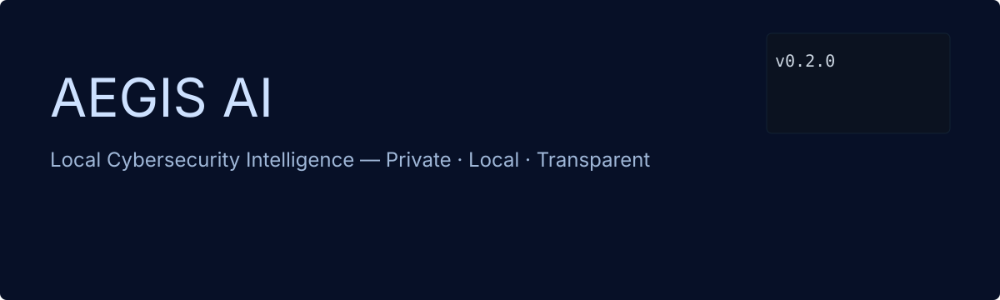

<p align="center">
  
</p>

<p align="center">
  <a href="README.md">🇬🇧 English</a> · <a href="#russian">🇷🇺 Русский</a>
</p>

<p align="center">
  <a href="LICENSE"></a>
  
  
  
</p>

---

## ⚡ О проекте

**AEGIS AI** — автономный набор инструментов для аудита безопасности, харденинга и расследования инцидентов, разработанный для **ИИ-агентов** (Antigravity, Claude Code, Cursor, Codex) и инженеров в терминале.

Объединяет в себе **Agent Skill (`SKILL.md`)** и легковесные Python-модули **без сторонних зависимостей** для локальной проверки Linux-систем, триажа логов и поиска секретов перед публикацией кода.

> [!NOTE]
> **Ноль внешних зависимостей**: AEGIS использует исключительно стандартную библиотеку Python и стандартные POSIX-утилиты. Никаких тяжелых библиотек, полная приватность и 100% локальная работа.

---

## 🛡️ Основные возможности

### 1. 🔍 Поиск утекших секретов и ключей (`scripts/aegis_scan.py`)
* Находит приватные ключи (RSA, OpenSSH, PGP, EC), GitHub PATs, ключи AWS, токены Telegram-ботов, API-ключи OpenAI/Gemini и строки подключения к базам данных.
* Автоматически маскирует найденные значения, чтобы избежать утечки в логи.
* Быстрый рекурсивный обход директорий с игнорированием бинарников и временных файлов сборки.

### 2. 🛡️ Аудит харденинга Linux (`scripts/aegis_audit.py`)
* Проверяет защиту памяти ядра (ASLR `randomize_va_space`).
* Сканирует системные директории на опасные бинарники с SUID/SGID битами (цели из каталога GTFOBins).
* Проверяет права доступа к критическим файлам (`/etc/passwd`, `/etc/shadow`) и директории `~/.ssh`.
* Находит сетевые порты, слушающие во внешнюю сеть (`0.0.0.0`), и проверяет конфиг SSH-сервера.
* Рассчитывает автоматический **рейтинг защищенности (0-100)** и оценку (A/B/C/D).

### 3. 📑 Анализ инцидентов и триаж логов (`scripts/aegis_triage.py`)
* **Логи авторизации (`auth.log`/`secure`)**: фиксирует всплески неудачных попыток входа по SSH, группирует IP атакующих, находит несанкционированные попытки вызова sudo.
* **Веб-логи (Nginx / Apache)**: выявляет попытки path traversal (`../`), поиск конфигов (`.env`, `wp-config.php`) и автоматизированные сканеры (`sqlmap`, `nikto`, `nuclei`, `gobuster`).

---

## 🚀 Быстрый старт

### Вариант А: Использовать как Agent Skill (Рекомендуется)

Скопируйте AEGIS в директорию скиллов вашего ИИ-агента:

```bash
# Для Google Antigravity / Agentic Coding Assistants:
git clone https://github.com/dyrnoi404/aegis-ai.git ~/.gemini/config/skills/aegis-security
```

После установки агент автоматически применяет правила `aegis-security` на запросы:
* *«Проверь безопасность моей системы»*
* *«Найди утекшие токены и ключи в проекте перед пушем»*
* *«Проанализируй /var/log/auth.log на попытки брутфорса»*

---

### Вариант Б: Использовать как автономный CLI

Запускайте AEGIS напрямую из командной строки:

```bash
# Клонировать репозиторий
git clone https://github.com/dyrnoi404/aegis-ai.git
cd aegis-ai

# 1. Проверить безопасность и харденинг хоста
./cli/aegis audit

# 2. Просканировать проект на утечку секретов
./cli/aegis scan /путь/к/проекту

# 3. Разобрать системные логи авторизации
./cli/aegis triage /var/log/auth.log
```

---

## 📜 Лицензия

Распространяется под лицензией **MIT**. Подробности в файле [LICENSE](LICENSE).

Разработка и поддержка: [@dyrnoi404](https://github.com/dyrnoi404) · [Telegram](https://t.me/not_mudota)
